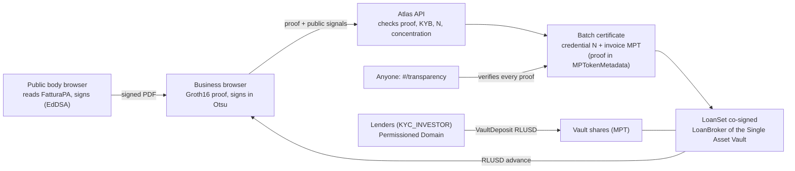

# Atlas: invoice financing with zero-knowledge proofs on the XRP Ledger

Atlas lets the suppliers of Italian public bodies get paid now. Small businesses that work for the Italian public administration wait months to be paid (the CJEU condemned Italy for it in case C-122/18, 2020), and to advance the money a financer usually has to see the invoice, and therefore the business's clients. Double financing is real too: at First Brands (2025), USD 2.3 billion "simply vanished" according to a creditor. Atlas is our take on the Tokenization of real-world assets: the public body confirms an invoice, the supplier turns it into a token that carries its own zero-knowledge proof on the XRP Ledger, and a vault funded by verified lenders advances 90% in seconds. The ledger refuses to finance the same invoice twice, and nobody but the two parties ever sees the invoice.

The numbers (from [`src/config/finance.ts`](src/config/finance.ts) and [`src/api/offer.test.ts`](src/api/offer.test.ts)): invoices are in US dollars and the fund lends RLUSD, Ripple's dollar stablecoin, at 1 RLUSD per dollar, so there is no exchange rate and no price feed. A $10,000 invoice due in 90 days gives the business 8,955 RLUSD right away (90% advance minus a 0.5% fee of 45 RLUSD), for a total cost of 178.16 RLUSD, about 8.1% a year. Lenders earn about 5.9% a year on the money lent; Atlas keeps 46.33 RLUSD per loan and its first-loss cover absorbs the first defaults.

## Demo

The product has three spaces with real accounts, plus a public Transparency page. It runs on the team's XRPL AlphaNet (NetworkID 1000, a dedicated node with the Lending Protocol, Batch and the other amendments enabled). That network has no public explorer, so every transaction opens its own detail page inside the app (`#/tx/<hash>`), with the decoded proof.

Lenders and businesses sign in either with the Otsu wallet (they keep their keys and sign each transaction themselves) or with an email account whose XRPL account Atlas manages. Public bodies sign in by email only.

1. **Landing** (`#/`): what Atlas does, three doors ("Lend", "I'm a public body", "I'm owed an invoice") and a link to Transparency.
2. **Lender** (`#/lend`): sign-up with a light KYC (the `KYC_INVESTOR` credential is issued), "Add test RLUSD", then a 5,000 RLUSD deposit; the fund's shares arrive as an MPT and the dashboard shows the position value and the variable yield.
3. **Tokenize invoice**, the business space (`#/business`): sign-up with a light KYB (company name, VAT number; the `KYB_PME` credential is issued). The space asks the business to have its client confirm the invoice on Atlas.
4. **Declare invoice**, the public body space (`#/public`): the Comune di Bari signs in and drops the FatturaPA of invoice FT-2026-0815 ($10,340, due in 90 days). The fields are read in the browser, the supplier is found by its VAT number, and "Confirm and sign" signs the invoice in the browser and downloads a signed PDF to send to the supplier: a readable invoice page that carries the signed attestation in its metadata.
5. **Tokenize invoice**: the business drops the signed PDF; its browser reads the attestation out of it, the check runs there and the offer appears: 9,000 RLUSD now, proven threshold $10,000, the exact amount stays private.
6. **"Get paid now"**: the proof is computed in the browser (about a second), then the certificate (an atomic `Batch`: nullifier `N` recorded, invoice MPT issued with the proof, handed to Atlas), Atlas's checks, and the co-signed `LoanSet`: 8,955 RLUSD received. Each step links to its transaction detail.
7. Dropping the same file again shows "Already financed", with a link to the ledger record of `N`.
8. **Transparency** (`#/transparency`): every proof behind the fund is verified again in the visitor's browser, along with the uniqueness of each `N`, the exposure per debtor pseudonym `P`, the share value and the utilisation rate. This page is what makes the invoice tokens people can trust rather than take on faith.
9. **Lender**: "Withdraw" exits immediately: Atlas buys the shares back at the current price minus 0.5% in an atomic `Batch`, and the RLUSD come back.

### Who signs what

With Otsu, Atlas prepares each transaction (sequence, fee and a deadline of 100 ledgers, about 5 minutes, from [`src/xrpl/preparedTx.ts`](src/xrpl/preparedTx.ts)), the user signs it in Otsu, and Atlas submits the signed blob only if it is exactly the one prepared. With an email account, Atlas signs every user transaction itself with the account it manages; no seed is ever shown.

| Step | What is signed | Signed by the user in Otsu | Signed by Atlas |
| --- | --- | --- | --- |
| Sign-in ([`walletAuthRoutes.ts`](src/api/fund/routes/walletAuthRoutes.ts)) | An `AccountSet` carrying a one-time nonce in its memo, never submitted | The `AccountSet` | Nothing |
| Account opening ([`onboardingRoutes.ts`](src/api/fund/routes/onboardingRoutes.ts), [`src/kyb/onboarding.ts`](src/kyb/onboarding.ts)) | `CredentialCreate` (`KYC_INVESTOR` or `KYB_PME`), then the user's `CredentialAccept`, `TrustSet` for RLUSD and, for lenders, `MPTokenAuthorize` on the vault shares, in one `Batch` | The `Batch` | The `CredentialCreate` |
| Lender deposit / withdraw, subscription period ([`lenderRoutes.ts`](src/api/fund/routes/lenderRoutes.ts), [`src/lending/lenderTrades.ts`](src/lending/lenderTrades.ts)) | `VaultDeposit` or `VaultWithdraw` | The vault transaction | Nothing |
| Lender deposit / withdraw, lending period | A `Batch` of two `Payment`s: shares one way, RLUSD the other, with Atlas's share stock and reserve | The `Batch` | Its inner `Payment`, through `BatchSigners` |
| Test RLUSD faucet (`POST /api/lender/faucet`, test networks only) | A `Payment` of 10,000 RLUSD from Atlas's test issuer | Nothing | The `Payment` |
| Business certificate ([`smeRoutes.ts`](src/api/fund/routes/smeRoutes.ts), [`src/invoice/issueCertificate.ts`](src/invoice/issueCertificate.ts)) | A `Batch`: `CredentialCreate` of `N`, `MPTokenIssuanceCreate` of the invoice token with its proof, Atlas's `MPTokenAuthorize`, transfer to Atlas | The `Batch` | Its `MPTokenAuthorize`, through `BatchSigners` |
| Loan ([`src/lending/loan.ts`](src/lending/loan.ts)) | `LoanSet` | The `LoanSet` | The `CounterpartySignature`, as LoanBroker |
| Repayment ([`loanRoutes.ts`](src/api/fund/routes/loanRoutes.ts)) | The public body's `Payment` to the business, then the business's `LoanPay` | The `LoanPay` | The public body's `Payment` (managed account) |
| Public body attestation ([`web/src/features/public-body/`](web/src/features/public-body/)) | The invoice, with EdDSA-Poseidon, in the browser; not a ledger transaction | Not applicable (email sign-in) | Nothing |

### Connect Otsu

[Otsu](https://github.com/RomThpt/otsu-wallet) is the XRPL Commons browser wallet extension.

1. Install the Otsu extension and create or import an account.
2. Add the AlphaNet: Otsu → Settings → Networks → Add custom network → the `XRPL_WS` URL of your node (the sign-in page shows the same path, from [`web/src/wallet/network.ts`](web/src/wallet/network.ts)).
3. On Atlas's sign-in page, click "Connect Otsu wallet" and approve the request in the Otsu window ([`web/src/features/account/WalletSignin.tsx`](web/src/features/account/WalletSignin.tsx)). A new wallet fills in the light KYC or KYB, then signs its account opening. "Continue with email" stays available.

A wallet that is not yet on the ledger is activated by Atlas when it signs in ([`walletAuthRoutes.ts`](src/api/fund/routes/walletAuthRoutes.ts)).

## How it works



This proof is the Crypto Vision of the project. The circuit ([`circuits/src/bari_invoice.circom`](circuits/src/bari_invoice.circom)) answers each of the lender's risks without revealing the invoice:

- **Authenticity**: the invoice carries a valid EdDSA-Poseidon signature by the debtor.
- **Verified debtor**: the debtor's key is a leaf of the Merkle tree of verified public bodies, whose root Atlas publishes.
- **Uniqueness**: the nullifier `N` is derived from the invoice and the debtor's secret; it is recorded as a Credential on the ledger, and a second `CredentialCreate` for the same `N` fails with `tecDUPLICATE`.
- **Sufficiency**: the amount is at least the public threshold tier. Tiers are $5,000, $10,000, $20,000, $50,000 and $100,000; the advance is 90% of the largest tier not above the invoice, paid in RLUSD, and only the tier becomes public.
- **Diversification**: the debtor pseudonym `P` lets Atlas cap the exposure per debtor (20% of the fund) without naming it.
- **Accountability**: the proof is bound to the business's XRPL account, and the commitment `C = Poseidon(m, r)` ties it to the exact signed invoice, which the business can open later if asked.

Accounts: lenders and businesses either connect Otsu and sign their own transactions, or use an email account whose XRPL account Atlas creates and holds (no seed is ever shown). KYC and KYB are issued as Credentials: `KYC_INVESTOR` for lenders, accepted by their account, and required by the Permissioned Domain that gates the private vault; `KYB_PME` for businesses, checked by Atlas before every advance. Each credential expires after one year.

The stablecoin is RLUSD as a trust-line token ([`src/xrpl/stablecoin.ts`](src/xrpl/stablecoin.ts), [`src/setup/stablecoin.ts`](src/setup/stablecoin.ts)). On the AlphaNet, Atlas's setup creates a test issuer that enables rippling, each holder opens its trust line and the issuer pays the balances. The issuer is read from `RLUSD_ISSUER` ([`src/config/network.ts`](src/config/network.ts)); on mainnet it would be Ripple's RLUSD issuer.

Privacy: the invoice never leaves the browsers of the public body and of the supplier. Atlas's server receives the proof and its public signals, plus lookups that carry no amount: VAT number → supplier account, and, during the supplier's pre-check, `N` → already recorded or not, supplier account → KYB done or not, and due date → offer. `N`, the account and the due date are public signals of the proof anyway. Proving everything a lender needs while keeping the invoice private is the other half of that Crypto Vision.

Effectiveness, in practice: tokenization is the core of the product (the invoice MPT carries its proof, the fund's shares are Multi-Purpose Tokens held by lenders), and the fund, the loans, the access rules and the double-financing guard are native ledger objects rather than a smart contract of our own. Invoices on public bodies are plain real-world assets; what changes is that each token carries verifiable value: its proof can be read from the ledger and checked by anyone.

## Built with

Every piece of ledger logic uses a native XRPL feature, which is where the Effectiveness of the design comes from:

- **Trust-line token**: RLUSD, the fund's stablecoin, [`src/xrpl/stablecoin.ts`](src/xrpl/stablecoin.ts).
- **Multi-Purpose Tokens**: the invoice token, whose proof sits in its metadata so that anyone holding it has tokens people can trust ([`src/invoice/invoiceToken.ts`](src/invoice/invoiceToken.ts), [`src/invoice/certificateMetadata.ts`](src/invoice/certificateMetadata.ts)), and the vault shares.
- **Single Asset Vault (XLS-65)**: the lenders' fund, [`src/setup/vault.ts`](src/setup/vault.ts).
- **Lending Protocol (XLS-66)**: LoanBroker and co-signed `LoanSet`, [`src/lending/loan.ts`](src/lending/loan.ts).
- **Credentials (XLS-70)**: KYC/KYB in [`src/kyb/`](src/kyb/), the nullifier registry in [`src/invoice/registry.ts`](src/invoice/registry.ts).
- **Permissioned Domains**: vault access for KYC'd lenders, [`src/setup/lenderDomain.ts`](src/setup/lenderDomain.ts).
- **Batch**: atomic certificate, account opening and instant lender entry/exit, co-signed by Atlas through `BatchSigners`, [`src/xrpl/batch.ts`](src/xrpl/batch.ts).
- **Otsu wallet**: non-custodial sign-in and signing, [`web/src/wallet/otsu.ts`](web/src/wallet/otsu.ts).
- **Groth16 circuit**: [`circuits/src/bari_invoice.circom`](circuits/src/bari_invoice.circom).
- **In-browser prover**: [`web/src/features/funding/`](web/src/features/funding/).
- **Transparency verifier**: re-checks every proof of the fund in the visitor's browser, so the verifiable value is not just Atlas's word, [`web/src/features/transparency/`](web/src/features/transparency/).

Stack: Node 22 and TypeScript, xrpl.js 5.4 beta, circom 2.2.2, snarkjs 0.7.6, Fastify, React 19 + Vite.

## Run locally

The proving key is versioned (`circuits/build/bari_invoice_final.zkey`), so there is no trusted setup to run.

```sh
npm ci
```

Network selection comes from environment variables, read by [`src/config/network.ts`](src/config/network.ts):

- `XRPL_WS`: WebSocket URL of the node.
- `XRPL_GENESIS_SEED`: seed of a funded wallet used to fund new accounts on a node without faucet (keep it out of the repo).
- `XRPL_WALLETS_FILE`: local file where the fund's wallets are stored.
- `RLUSD_ISSUER`: RLUSD issuer address; without it, Atlas's setup creates its own test issuer.

Without them, Atlas targets the public XRPL devnet, funds accounts through its faucet and stores wallets in `.wallets.devnet.json`. Note that devnet does not have every amendment our node enables.

```sh
npm run demo:fund   # create or reuse the fund, its accounts and the history loans
npm run api:fund    # API on 127.0.0.1:8788
npm run web         # front on http://localhost:5173
```

To sign with your own wallet, follow [Connect Otsu](#connect-otsu) above.

Tests: `npm test` (unit and integration), `npx playwright test` (end-to-end, against a live network). Public audit of a fund from the ledger alone: `npm run audit -- <Vault or LoanBroker ID>`.

## Known limitations

- KYC and KYB are self-declared ("Verification: basic"); a regulated KYC provider could issue the same credentials without changing the vault or the checks.
- Xaman and GemWallet cannot sign on a private network, so the non-custodial option is Otsu only.
- Email accounts stay custodial: Atlas holds their XRPL keys. Public bodies sign in by email only.
- In a `Batch` co-signed by Atlas (certificate, lender entry or exit during the lending period), Atlas's sequence is fixed when the request is prepared. If Atlas submits another transaction before the user signs (within about 5 minutes), the certificate is refused with "Atlas's part of this request is out of date. Start again." and a lender trade fails on the ledger with nothing moved but the network fee; in both cases the user starts again.
- The public bodies' attestation keys are derived from a public secret (`DEMO_DEBTOR_SECRET` in [`src/zk/constants.ts`](src/zk/constants.ts)) and served to that body's session only. In production each body would keep its own keys.
- The vault is closed during the lending period (the ledger requires it for a LoanBroker), so immediate entry and exit go through Atlas's share stock and RLUSD reserve.
- The RLUSD on the AlphaNet come from Atlas's test issuer, not from Ripple.
- The Groth16 setup has 2 contributions and a demo beacon; it is not a production ceremony.
- The proof is verified off-ledger, by Atlas and by anyone on the Transparency page, not by the ledger itself.
- Everything runs on a test network.

## AI disclosure

We used Claude Code with Claude models (Anthropic) as a coding assistant throughout the project.

- **Solution design and code generation**: the idea, the product design, the core architecture and the circuit come from the team, which built the first version of the ledger flow and the circuit before the event (see the git history from 20/11) and directed every change. Large parts of the code, including the XRPL integration, the API, the front end, the unit tests and the Playwright end-to-end tests, were written with the AI assistant under the team's direction and review.
- **Documentation**: this README, the specs and the internal docs were drafted with AI assistance and edited by the team.
- **Pitch preparation**: the pitch script was drafted with AI assistance and reviewed by the team.
