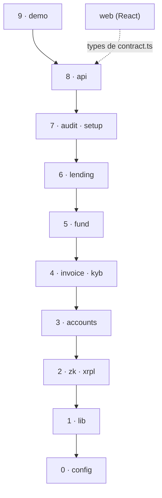

# Architecture : la carte des composants

Un composant est un dossier de `src/` (et `web/` pour le front). Les composants sont rangés en couches, et un import ne descend jamais vers le haut. La carte est exécutable : `src/architecture.test.ts` la vérifie à chaque `npm test`.

## Règles

1. **Dépendances descendantes uniquement.** Un composant n'importe que des composants de couche strictement inférieure, ce qui exclut tout cycle. Un nouveau dossier dans `src/` doit être ajouté à `LAYERS` (dans `src/architecture.test.ts`) et à ce document, sinon `npm test` échoue.
2. **Le front ne connaît que le contrat.** `web/` n'importe du back que `src/api/contract.ts` (types partagés) ; tout le reste passe par HTTP.
3. **API publique.** Un composant n'utilise d'un autre que ce qui est listé dans le tableau ci-dessous. Chaque composant reçoit un `index.ts` quand on le passe en TDD ; `zk` en a déjà un.
4. **Entrées-sorties injectées.** Le code nouveau ou réécrit en TDD reçoit le ledger, le prouveur, l'horloge et l'état par des ports, pour être testé sans réseau. Le premier port, `Ledger` (voir plus bas), est créé avec le premier test qui en a besoin.

## Couches



Une flèche signifie « peut importer les couches en dessous », à n'importe quelle distance.

## Composants

| Couche | Composant | Rôle | Dépend de | API publique (utilisée par les autres) | Tests |
|---|---|---|---|---|---|
| 0 | `config` | paramètres financiers, calendrier de cohorte, réseau ; surchargeables par l'environnement | — | `finance.ts`, `cohort.ts`, `network.ts` | — |
| 1 | `lib` | montants, taux, encodages, journal | config | `amounts`, `rates`, `encoding`, `log`, `onLogEvent` | — |
| 2 | `zk` | attestation du débiteur, arbre de Merkle, preuve Groth16, vérification, encodage de la preuve pour les métadonnées | — | `zk/index.ts` ; `constants` et `field.randomField` sont encore importés directement par `api`, à faire passer par l'index | `zk.test.ts` (11 tests, exigent la zkey) |
| 2 | `xrpl` | adaptateur XRPL : soumission, `Batch`, lecture d'objets, heure du ledger, métadonnées, MPT | lib | `submit`, `batch`, `ledgerEntries`, `ledgerTime`, `meta`, `mpt` | — |
| 3 | `accounts` | acteurs de la démo, wallets, financement des comptes | config, lib, xrpl | `actors` | — |
| 4 | `invoice` | certificat de facture : facture, attestation → preuve → métadonnées, registre `N`, MPT facture, émission en `Batch`, vérification de la preuve | config, lib, xrpl, zk | `certificate`, `certificateMetadata`, `debtors`, `invoice`, `invoiceToken`, `issueCertificate`, `proofVerification`, `registry` | — |
| 4 | `kyb` | identité : credentials KYC/KYB (émission et acceptation), KYB de la PME | accounts, lib, xrpl | `kycCredentials`, `smeKyb` | — |
| 5 | `fund` | modèle du fonds (`Fund`, `Cohort`), fiche publique du Vault, `Data` du `LoanSet`, lecture des prêts, inspection d'un certificat, concentration par `P` | config, invoice, lib, xrpl | `fund`, `fundManifest`, `loanData`, `loanRecords`, `invoiceInspection`, `concentration` | — |
| 6 | `lending` | conditions et économie du prêt, contrôles de Bari avant co-signature, `LoanSet`, remboursement, défaut, souscription, rachat | accounts, config, fund, invoice, kyb, lib, xrpl | `loan`, `loanTerms`, `economics`, `repayment`, `defaultFlow`, `subscription`, `redemption` | — |
| 7 | `audit` | audit public du fonds, depuis le ledger seul | config, fund, invoice, lib, xrpl, zk | `auditFund` | — |
| 7 | `setup` | mise en place du fonds : stablecoin, domaine des prêteurs, Vault fermé, LoanBroker | accounts, config, fund, invoice, kyb, lending, lib, xrpl | `setupFund` | — |
| 8 | `api` | deux serveurs : `node:http` (port 8787 : `/api/check`, `/api/kyb`) et Fastify (port 8788 : fonds, certificat, prêt, audit, SSE) ; `contract.ts` = types partagés avec le front | toutes les couches inférieures | `contract.ts`, `attestedInvoice.ts` | `npm run api:smoke` (devnet) |
| 9 | `demo` | scénarios en ligne de commande (`demo`, `samples`) | toutes les couches inférieures | — | `npm run demo` (devnet) |
| — | `web` | front React/Vite : landing, KYB, pré-contrôle d'une facture attestée | `src/api/contract.ts` | — | — |

## Le port `Ledger` (contrat de départ)

Il couvre les lectures dont ont besoin `lending/loanChecks.ts` et `fund/invoiceInspection.ts`, une méthode par commande rippled. L'adaptateur réel vit dans `xrpl/` et enveloppe `Client` ; les tests utilisent un faux en mémoire.

```ts
export interface Ledger {
  networkId(): number;
  closeTime(): Promise<number>;
  credential(subject: string, issuer: string, typeHex: string): Promise<LedgerEntry.Credential | undefined>;
  mptIssuance(id: string): Promise<LedgerEntry.MPTokenIssuance | undefined>;
  mptBalance(id: string, holder: string): Promise<bigint>;
  vault(id: string): Promise<LedgerEntry.Vault>;
  loanBroker(id: string): Promise<LedgerEntry.LoanBroker>;
  accountObjects(account: string, type: string): Promise<LedgerEntry.LedgerEntry[]>;
  transaction(hash: string): Promise<TxResponse["result"]>;
}
```

Il remplace le `Client` brut module par module, en commençant par ceux qu'on modifie. Les 17 modules qui reçoivent aujourd'hui un `Client` ne sont pas migrés d'un bloc.

## TDD

- **Où :** à côté du code, `src/<composant>/<module>.test.ts`. `npm test` lance tous les `src/**/*.test.ts` (node:test + tsx).
- **Cycle :** test rouge → code minimal → vert → refactorisation, un comportement à la fois.
- **Sans réseau :** `npm test` n'appelle jamais le devnet. On teste la logique pure, ou on utilise un faux `Ledger`.
- **Intégration :** `npm run api:smoke` et `npm run demo` sur devnet, lancés à la main avant de pousser.
- **Front :** la logique d'un parcours vit dans une machine d'état pure, testée avec le même runner. Les composants React restent minces : affichage et événements.
- **Tests ZK :** ils exigent la zkey `circuits/build/bari_invoice_final.zkey`, qui n'est pas dans le dépôt. Il faut la copier depuis la machine qui a lancé `zk:setup`. Ne pas relancer `zk:setup` : la vkey changerait et les certificats déjà émis deviendraient invalides.
