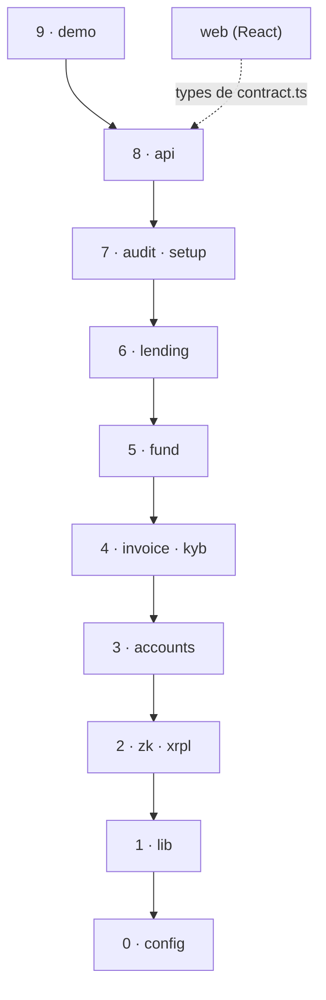

# Architecture : la carte des composants

Un composant est un dossier de `src/` (et `web/` pour le front). Les composants sont rangés en couches, et un import ne descend jamais vers le haut. La carte est exécutable : `src/architecture.test.ts` la vérifie à chaque `npm test`.

## Règles

1. **Dépendances descendantes uniquement.** Un composant n'importe que des composants de couche strictement inférieure, ce qui exclut tout cycle. Un nouveau dossier dans `src/` doit être ajouté à `LAYERS` (dans `src/architecture.test.ts`) et à ce document, sinon `npm test` échoue.
2. **Le front ne connaît que le contrat.** `web/` n'importe du back que `src/api/contract.ts` (types partagés) ; tout le reste passe par HTTP.
3. **API publique.** Un composant n'utilise d'un autre que ce qui est listé dans le tableau ci-dessous. Chaque composant reçoit un `index.ts` quand on le passe en TDD ; `zk` en a déjà un.
4. **Entrées-sorties injectées.** Le code nouveau ou réécrit en TDD reçoit le ledger, le prouveur, l'horloge et l'état par des ports, pour être testé sans réseau. Le premier port, `Ledger` (voir plus bas), vit dans `xrpl/ledger.ts`.

## Couches



Une flèche signifie « peut importer les couches en dessous », à n'importe quelle distance.

## Composants

| Couche | Composant | Rôle | Dépend de | API publique (utilisée par les autres) | Tests |
|---|---|---|---|---|---|
| 0 | `config` | paramètres financiers, calendrier de cohorte, réseau ; surchargeables par l'environnement | — | `finance.ts`, `cohort.ts`, `network.ts` | — |
| 1 | `lib` | montants, taux, encodages, journal | config | `amounts`, `rates`, `encoding`, `log`, `onLogEvent` | — |
| 2 | `zk` | attestation du débiteur, arbre de Merkle, preuve Groth16, vérification, encodage de la preuve pour les métadonnées | — | `zk/index.ts` ; `constants` et `field.randomField` sont encore importés directement par `api`, à faire passer par l'index | `zk.test.ts` (11 tests, exigent la zkey) |
| 2 | `xrpl` | adaptateur XRPL : soumission (port `SubmitTx`), `Batch` (port `SubmitBatch` à deux signataires), lecture d'objets, heure du ledger, métadonnées, MPT, RLUSD en ligne de confiance (`stablecoin` : unités ↔ valeur décimale du ledger, montant IOU, `TrustSet`, `Payment`, solde par `account_lines`) ; port `Ledger` et son faux en mémoire | config, lib | `ledger`, `submit`, `batch`, `ledgerEntries`, `ledgerTime`, `meta`, `mpt`, `stablecoin` ; `fakeLedger` (tests seulement) | `stablecoin.test.ts` |
| 3 | `accounts` | acteurs de la démo, wallets, financement des comptes (et activation d'un wallet connu par sa seule adresse, port `ActivateAddress`) ; comptes des utilisateurs (`userStore` : custody `managed` = email, haché `scrypt`, compte XRPL géré ; custody `wallet` = adresse du wallet de l'utilisateur, sans email ni seed ; rôle, profil, prix de revient des parts d'un prêteur, secret de session, dans `.bari-state.<réseau>.users.json` ; port `ProvisionAccount`) | config, lib, xrpl | `actors`, `funding`, `userStore` | `userStore.test.ts` |
| 4 | `invoice` | certificat de facture : facture, attestation → preuve → métadonnées, registre `N`, MPT facture, émission en `Batch`, vérification de la preuve | config, lib, xrpl, zk | `certificate`, `certificateMetadata`, `debtors`, `invoice`, `invoiceToken`, `issueCertificate`, `proofVerification`, `registry` | — |
| 4 | `kyb` | identité : credentials KYC/KYB (émission et acceptation, expiration), KYB de la PME de démo, ouverture du compte géré par rôle (`onboarding` : compte financé, `KYC_INVESTOR` ou `KYB_PME` d'un an, `TrustSet` RLUSD, `MPTokenAuthorize` des parts pour un prêteur) | accounts, lib, xrpl | `kycCredentials`, `smeKyb`, `onboarding` | `onboarding.test.ts` (faux `SubmitTx`) |
| 5 | `fund` | modèle du fonds (`Fund`, `Cohort`), fiche publique du Vault, `Data` du `LoanSet`, lecture des prêts, inspection d'un certificat, concentration par `P`, prix de la part, rendement variable et cotations immédiates plafonnées par Bari (`sharePrice`) | config, invoice, lib, xrpl | `fund`, `fundManifest`, `loanData`, `loanRecords`, `invoiceInspection`, `concentration`, `sharePrice` | `sharePrice.test.ts` |
| 6 | `lending` | conditions du prêt par palier public (5 000 à 100 000 € ; avance = 90 % du palier prouvé en RLUSD, 1 € = 1 RLUSD sans oracle, frais 0,5 % de l'avance) et économie du prêt, contrôles de Bari avant co-signature rendus un par un avec leur raison (`reviewLoan` : KYB, preuve, avance, unicité, concentration, échéance), `LoanSet` pour un emprunteur quelconque (montants en valeur RLUSD du ledger), remboursement, défaut, souscription, rachat, ordres des prêteurs (`lenderTrades` : VaultDeposit / VaultWithdraw, ou `Batch` de deux `Payment` avec Bari) | accounts, config, fund, invoice, kyb, lib, xrpl | `loan`, `loanTerms`, `economics`, `repayment`, `defaultFlow`, `subscription`, `redemption`, `lenderTrades` | `loanTerms.test.ts`, `loan.test.ts` (`LoanSet` construit), `loanChecks.test.ts` (faux `Ledger`, exige la zkey), `lenderTrades.test.ts` (faux `SubmitTx` / `SubmitBatch`) |
| 7 | `audit` | audit public du fonds, depuis le ledger seul | config, fund, invoice, lib, xrpl, zk | `auditFund` | — |
| 7 | `setup` | mise en place du fonds : RLUSD (émetteur `RLUSD_ISSUER` ou émetteur de test de Bari : `asfDefaultRipple`, `TrustSet` des détenteurs, émission par `Payment`), domaine des prêteurs, Vault fermé d'actif RLUSD (`Scale` 6), LoanBroker | accounts, config, fund, invoice, kyb, lending, lib, xrpl | `setupFund`, `stablecoin` | — |
| 8 | `api` | un serveur Fastify (port 8788 : comptes et sessions, connexion par wallet Otsu (`routes/walletAuthRoutes.ts` : défi à usage unique de 5 min, `AccountSet` signé par la clé maîtresse et jamais soumis, nonce en mémo, jeton d'inscription signé, `GET /api/network`), fonds, espace prêteur, lectures publiques du pré-contrôle et barème des paliers, paramètres de la preuve, espace entreprise : certificat et prêt pour le compte géré de la session, factures du compte, remboursement par le compte emprunteur, audit, détail de transaction, SSE) ; `auth.ts` = cookie de session signé HMAC, jeton d'inscription d'un wallet et garde `requireRole` (401 sans session, 403 pour un autre rôle) ; `contract.ts` = types partagés avec le front | toutes les couches inférieures | `contract.ts`, `attestedInvoice.ts` | `app.test.ts`, `stateStore.test.ts`, `routes/authRoutes.test.ts` et `routes/walletAuthRoutes.test.ts` (faux contexte `fakeContext.ts`, sans réseau), `routes/lenderRoutes.test.ts` et `routes/loanRoutes.test.ts` (faux `Ledger`, faux ports `LenderPorts` passés à `buildApp`), `offer.test.ts`, `routes/txRoutes.test.ts`, `routes/zkRoutes.test.ts`, `zkInputs.test.ts`, `routes/smeRoutes.test.ts` (faux `Ledger`, exigent la zkey) ; `npm run api:smoke` (devnet) |
| 9 | `demo` | scénarios en ligne de commande (`demo`, `demo:fund`, `samples`) ; étapes communes dans `financing.ts` | toutes les couches inférieures | — | `fundReuse.test.ts` ; `npm run demo` (devnet), `npm run demo:fund` (fonds durable repris par l'API) |
| — | `web` | front React/Vite : landing, comptes (`features/account` : email, ou wallet Otsu par `wallet/otsu.ts` et `wallet/network.ts`), KYB, pré-contrôle et preuve Groth16 calculés dans le navigateur (`features/funding`), détail de transaction | `src/api/contract.ts` | — | `features/**/*.test.ts`, `wallet/*.test.ts` ; e2e Playwright (`web/e2e`, faux Otsu `e2e/fixtures/otsuMock.ts`) |

## Le port `Ledger`

Il couvre les lectures dont ont besoin `lending/loanChecks.ts`, `lending/loan.ts`, `lending/repayment.ts`, `lending/subscription.ts`, `lending/redemption.ts`, `fund/invoiceInspection.ts`, `fund/loanRecords.ts`, `invoice/registry.ts` (`getRegistration`), `kyb/smeKyb.ts` (`isSmeKybDone`), la vue du fonds (`api/fund/fundView.ts`), l'espace prêteur (`api/fund/routes/lenderRoutes.ts`) et la route `GET /api/tx/:hash` (`ApiContext.ledger`), une méthode par commande rippled, toujours sur le ledger validé. L'adaptateur réel, `xrplLedger(client)`, vit dans `xrpl/ledger.ts` et enveloppe `Client` ; les tests utilisent `FakeLedger` (`xrpl/fakeLedger.ts`), un faux en mémoire.

```ts
export interface Ledger {
  networkId(): number | undefined;
  credential(subject: string, issuer: string, typeHex: string): Promise<LedgerEntry.Credential | undefined>;
  mptIssuance(id: string): Promise<LedgerEntry.MPTokenIssuance | undefined>;
  mptBalance(id: string, holder: string): Promise<bigint>;
  stablecoinBalance(asset: Stablecoin, holder: string): Promise<bigint>; // ligne de confiance (account_lines), en unités, 0 sans ligne
  vault(id: string): Promise<LedgerEntry.Vault>; // lève une erreur si absent
  loanBroker(id: string): Promise<LedgerEntry.LoanBroker>; // lève une erreur si absent
  loan(id: string): Promise<LedgerEntry.Loan>; // lève une erreur si absent
  accountObjects(account: string, type: AccountObjectType): Promise<LedgerEntry.LedgerEntry[]>;
  transaction(hash: string): Promise<TxResponse["result"] | undefined>; // undefined si txnNotFound
  closeTime(): Promise<number>; // heure de clôture du dernier ledger validé, en temps Ripple
}
```

`closeTime()` sert aux contrôles de Bari avant co-signature (l'échéance du prêt doit tomber avant le rachat) ; dans les tests, `FakeLedger.setCloseTime(time)` la fixe (0 par défaut).

Il remplace le `Client` brut module par module, en commençant par ceux qu'on modifie ; les appelants qui ont encore un `Client` construisent l'adaptateur sur place (`xrplLedger(client)`).

**Unicité de `N` entre les fonds.** Avant de co-signer, Bari liste ses LoanBroker (`accountObjects(bari, "loan_broker")`), puis les prêts de chacun et la référence portée par leur `LoanSet` : un `N` déjà référencé par un prêt de n'importe quel fonds Bari est refusé, pas seulement dans le fonds courant.

## TDD

- **Où :** à côté du code, `src/<composant>/<module>.test.ts`. `npm test` lance tous les `src/**/*.test.ts` (node:test + tsx).
- **Cycle :** test rouge → code minimal → vert → refactorisation, un comportement à la fois.
- **Sans réseau :** `npm test` n'appelle jamais le devnet. On teste la logique pure, ou on utilise un faux `Ledger`.
- **Intégration :** `npm run api:smoke` et `npm run demo` sur devnet, lancés à la main avant de pousser.
- **Front :** la logique d'un parcours vit dans une machine d'état pure, testée avec le même runner. Les composants React restent minces : affichage et événements.
- **Tests ZK :** ils exigent la zkey `circuits/build/bari_invoice_final.zkey`, qui n'est pas dans le dépôt. Il faut la copier depuis la machine qui a lancé `zk:setup`. Ne pas relancer `zk:setup` : la vkey changerait et les certificats déjà émis deviendraient invalides.
